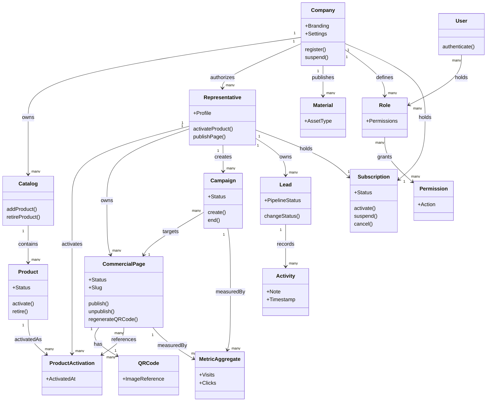
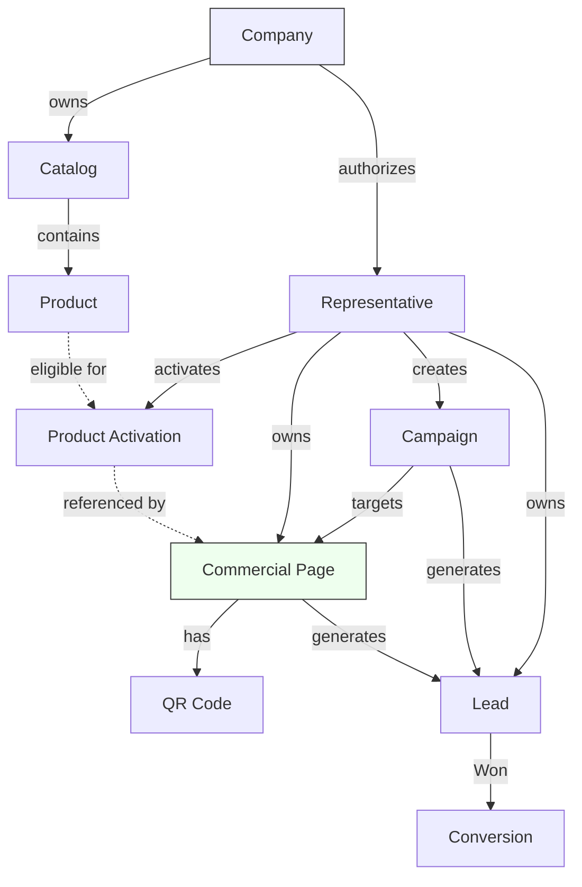
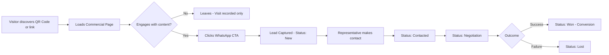
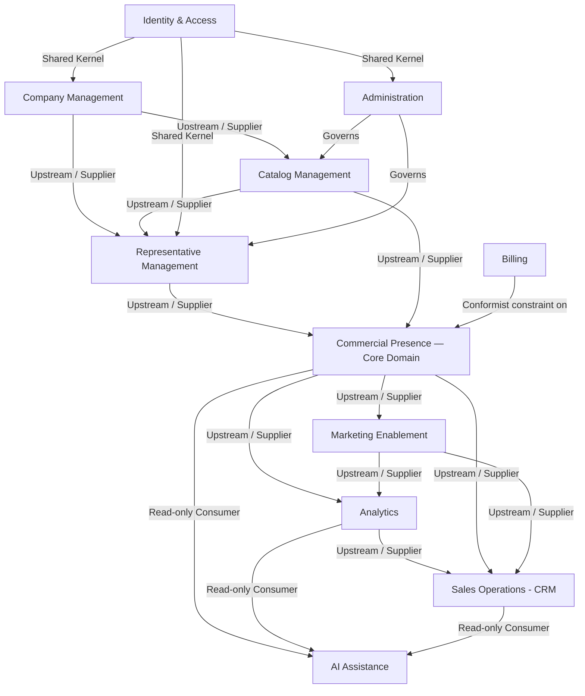

# DOMAIN_MODEL.md

> Business Domain Specification
> Version: 2.0
> Status: Active
> Authority: Level 4 — business language and modelling (see `docs/README.md`)
> Product: SETNAR

> **Read § 3.1 before acting on anything in this document.** Most of what is
> modelled here does not exist in code and is not scheduled to. A modelled
> entity is a piece of vocabulary, never an instruction to build.

---

# 1. Purpose

### Account phone versus professional phone

`profiles.phone` is a nullable, owner-readable snapshot captured at signup
only to prefill onboarding. It may be absent for legacy accounts and is not
an authentication factor. After the user confirms onboarding,
`representatives.phone` is the canonical commercial phone for settings,
publication and WhatsApp; no bidirectional synchronization is implied.

This document is the definitive business specification of SETNAR. It exists so that every future implementation decision — regardless of who makes it, human or AI — can be traced back to an explicit business concept, rule, or rationale defined here, rather than to an assumption made in code.

SETNAR is being built incrementally, one validated stage at a time, per ROADMAP.md. A Domain Model is what keeps that incremental delivery coherent: it lets the team add Stage 2 (Optimize), Stage 3 (Sell), Stage 4 (Automate) and beyond without rewriting Stage 1, because the business concepts were modeled correctly from the start, even though only a subset of their behavior is implemented today.

This document derives every decision from PRODUCT_CONSTITUTION.md first, and from the five other existing project documents (PRODUCT.md, ARCHITECTURE.md, DESIGN_SYSTEM.md, ROADMAP.md, ENGINEERING_GUIDELINES.md) to the extent they are themselves consistent with it. It does not introduce features, entities, or business rules that are not implied or required by those documents. Where those documents are silent, this document makes the minimal, most conservative extension necessary for the model to be internally consistent, and flags it explicitly as an inferred decision rather than a sourced one.

This document describes the business. It intentionally says nothing about databases, APIs, frameworks, or code.

---

# 2. Business Vision

SETNAR exists because independent professionals authorized by an organization — licensed representatives, consultants, agents, affiliates, franchisees, brokers — currently represent brands and sell products without any professional digital infrastructure of their own. They rely on scattered PDFs, generic link-in-bio tools, and disorganized WhatsApp threads. This is a credibility problem as much as a tooling problem: a prospective customer has no way to distinguish a serious independent professional from an opportunistic one.

SETNAR's business bet is that giving each of these professionals a *Digital Office* — a personalized, credible, always-on digital presence tied to the products they are authorized to sell — increases their conversion rate and, in turn, makes them willing to pay for the platform.

The business is deliberately **not** a website builder. A website builder's unit of value is a page.

**SETNAR's central unit of value is a trustworthy, professional, authorized interaction between an independent representative and a potential customer.** Leads, opportunities and conversions are measurable outcomes of that interaction, but they are not its only manifestation of value: a visitor who takes the representative seriously, an authorizing organization protected from misrepresentation, and a professional who can be found and verified are all value delivered, whether or not a sale follows.

This correction matters for modelling. Defining value as "a sales opportunity per product" would justify optimizing exclusively for conversion events and would put the model in conflict with PRODUCT_CONSTITUTION.md Core Beliefs 1 and 7 — credibility earned through transparency, and two parties served whose interests are not automatically aligned. Every business concept in this model exists to support that trustworthy interaction: a Representative belonging to a Company, offering Products from a Catalog, through a Commercial Page, generating traceable interest that can be worked into a Conversion.

The business validates itself one stage and one vertical at a time (Stage 1 targets iGreen representatives specifically), but the domain itself is never modeled around any single company. iGreen is the first tenant of a multi-tenant business, not a template the business is built around. This distinction is the single most important modeling decision in this document and it recurs throughout: every entity that could be tempted to assume "the company" or "the product type" instead assumes "a Company" and "a Product," scoped generically.

---

# 3. Ubiquitous Language

This is the single authoritative vocabulary of the SETNAR business. Every future document, conversation, or specification must use these terms with these exact meanings. Where a Portuguese-market term differs from the English one used internally, both are given.

### Company
**Definition:** A business entity that recruits, authorizes, and organizes independent professionals to represent its products.
**Business meaning:** The tenant of the platform. Every other business object exists in the context of exactly one Company. A Company is the boundary of branding, product catalog, and administrative authority.
**Example:** iGreen Energy is a Company. A future insurance brokerage onboarded in Stage 5 would be a different Company.
**Relationships:** Owns Catalogs, employs/authorizes Representatives, defines Roles and Permissions, is the tenant boundary for Analytics and Billing.

### Representative
**Definition:** An independent professional authorized by exactly one Company to sell that Company's Products under their own name and identity.
**Business meaning:** The primary user and beneficiary of SETNAR. A Representative is not an employee — they operate independently but derive credibility and tooling from their affiliation with the Company.
**Example:** A licensed iGreen representative who sells Conexão Green and Conexão Solar.
**Relationships:** Belongs to exactly one Company; owns one Commercial Page per activated Product (or a unified Commercial Page presenting several); is the subject of Analytics; receives Leads.

**Stage 1 profile invariant:** a Representative has a public professional name, an authorization identifier and a commercial phone. The phone is a contact attribute of the Representative, not an authentication factor, and is stored canonically for the WhatsApp CTA. Legacy rows that predate this invariant may remain incomplete temporarily, but cannot publish and must be given a correction path; no fictitious value may be inferred. The User Profile's `full_name` may prefill onboarding, but it remains a distinct identity value from the Representative's editable public name.

### User
**Definition:** The authenticated identity that logs into SETNAR. Distinguished from Representative because, in future stages (Enterprise), a User may hold administrative or supervisory roles without being a sales Representative themselves.
**Business meaning:** Identity and access concept, kept intentionally separate from the sales-facing Representative role so that Stage 5 (multi-role administration) doesn't require redefining who "logs in."
**Example:** In Stage 1, every User is a Representative. In Stage 5, a Company administrator is a User but not necessarily a Representative.
**Relationships:** Has one Profile; is granted a Role within a Company; may or may not carry the Representative capability.

### Catalog
**Definition:** The collection of Products a Company makes available to its Representatives.
**Business meaning:** The Catalog is how a Company controls what can legally and commercially be offered to customers. It is the mechanism of product governance.
**Example:** iGreen's Catalog includes Conexão Green, Conexão Solar, Conexão Placas, Conexão Club, iGreen Seguros, iGreen Telecom.
**Relationships:** Belongs to exactly one Company; contains many Products; a Representative activates Products from their Company's Catalog only.

### Product
**Definition:** A specific offer a Company sells through its Representatives, with its own description, compliance requirements, and commercial terms.
**Business meaning:** The sellable unit. Everything a Commercial Page ultimately promotes is a Product (or a set of Products).
**Example:** "Conexão Solar" (subscription solar energy) and "iGreen Auto Mensal" (monthly car insurance) are two distinct Products in the same Catalog.
**Relationships:** Belongs to exactly one Catalog; can be activated by many Representatives; is referenced by one or more Commercial Pages.

### Product Activation
**Definition:** The explicit act by which a Representative opts in to offer a specific Product from their Company's Catalog.
**Business meaning:** Representatives do not automatically sell everything in the Catalog; they choose what to activate, which determines what appears on their Commercial Page and what they can legally represent.
**Example:** A Representative activates Conexão Green and iGreen Seguros but not iGreen Telecom.
**Relationships:** Connects a Representative to a Product; is a precondition for that Product appearing on a Commercial Page.

### Commercial Page
**Definition:** The public-facing, personalized digital page that presents a Representative and the Products they have activated, ending in a call to action (WhatsApp contact).
**Business meaning:** The core deliverable of the MVP. It is what a Representative shares instead of a PDF or a raw WhatsApp number.
**Example:** `joao-silva.setnar.com.br` showing João's photo, his iGreen affiliation, and his activated Products.
**Relationships:** Owned by exactly one Representative; references one or more Products; has one QR Code; is the target of Visitor traffic and the origin of Leads.

### QR Code
**Definition:** A generated, scannable visual representation of a Commercial Page's (or, later, Campaign's) link.
**Business meaning:** Enables offline-to-online conversion — a Representative can hand a printed QR Code to a prospect who has no reason to type a URL.
**Example:** A QR Code printed on a Representative's business card, linking to their Commercial Page.
**Relationships:** Belongs to exactly one Commercial Page in Stage 1; in Stage 2, a "Smart QR Code" can belong to a Campaign instead, to enable performance tracking per physical placement.

### Visitor
**Definition:** An anonymous person who accesses a Commercial Page.
**Business meaning:** The raw traffic event, before any identity or intent is known. Visitors are the top of the funnel that Analytics measures.
**Example:** Someone who scans a QR Code and lands on the page but leaves without clicking WhatsApp.
**Relationships:** Generates Analytics events against a Commercial Page (and, later, a Campaign); may or may not become a Lead.

### Analytics (Metrics)
**Definition:** The aggregated and individual record of how Visitors interact with a Representative's digital presence.
**Business meaning:** Proof of value for the Representative ("is this actually generating interest?") and the mechanism by which SETNAR's product metrics (QR Codes Generated, WhatsApp Click Rate) are measured.
**Example:** Visits, unique visitors, WhatsApp clicks, referrer source (Stage 1); devices, cities, conversion rate (Stage 2).
**Relationships:** Always scoped to a Commercial Page (Stage 1) or a Campaign (Stage 2); aggregates Visitor events.

### Campaign
**Definition:** A named, trackable marketing initiative that wraps a distinct link (and optionally a Smart QR Code) around a Representative's offer, so its performance can be measured separately from organic traffic.
**Business meaning:** Lets a Representative answer "did this specific flyer / this specific post work?" rather than only seeing undifferentiated page traffic.
**Example:** A Representative creates a Campaign called "Feira de Bairro Outubro" with its own link and QR Code.
**Relationships:** Belongs to exactly one Representative; generates its own Analytics; may generate Leads attributed to it specifically.

### Material
**Definition:** A reusable marketing asset (image, video, PDF, presentation) made available to Representatives to support their sales activity.
**Business meaning:** Reduces the burden on Representatives to produce their own marketing content, while giving the Company control over brand-compliant assets.
**Example:** An approved product explainer PDF for Conexão Solar.
**Relationships:** Belongs to a Company (or a Product within it); is used by, but not owned by, Representatives.

### Lead
**Definition:** A person who has expressed identifiable interest in a Representative's offer (typically by initiating WhatsApp contact or another tracked conversion action) and is now being tracked as a discrete sales opportunity.
**Business meaning:** The moment an anonymous Visitor becomes an actionable prospect. This is the entry point into the Sales/CRM domain (Stage 3).
**Example:** A Visitor clicks "Talk on WhatsApp" and is recorded as a Lead for that Representative.
**Relationships:** Belongs to exactly one Representative; references the Commercial Page and/or Campaign it originated from; owns a Timeline of Activities and a Pipeline Status.

### Pipeline Status
**Definition:** The current stage of a Lead within a Representative's sales process: New, Contacted, Negotiation, Won, Lost.
**Business meaning:** Gives Representatives a simple, standard way to manage where each prospect stands, without needing external CRM software.
**Relationships:** Owned by exactly one Lead; changes over time following defined transitions (see Section 14).

### Activity / Timeline Entry
**Definition:** A recorded interaction or note associated with a Lead over time (a call made, a message sent, a status change).
**Business meaning:** Gives a Representative (and, in Enterprise, their Company) a history of how a prospect was worked, supporting accountability and follow-up.
**Relationships:** Belongs to exactly one Lead.

### Conversion
**Definition:** The business outcome in which a Lead results in a Pipeline Status of "Won" — i.e., an actual sale attributable to the Representative's digital presence.
**Business meaning:** The ultimate metric of product success; ties directly to the Company's and the Representative's revenue.
**Relationships:** Is a state reached by a Lead; is what Conversion Rate (an Analytics/Product metric) measures.

### Subscription
**Definition:** The commercial agreement between a paying customer (a Representative, or in Enterprise a Company) and SETNAR itself, granting access to the platform's capabilities.
**Business meaning:** This is SETNAR's own revenue model — not to be confused with a Company's Product subscriptions (e.g., "Conexão Green" is itself sold as a subscription to end consumers, but that is a Product, not a SETNAR Subscription).
**Relationships:** Belongs to a Representative (Stage 1–4) or a Company (Stage 5, Enterprise plans); determines feature and usage entitlements.

### Role
**Definition:** A named set of Permissions that can be assigned to a User within a Company.
**Business meaning:** Enables the Enterprise stage's requirement that authorization be permission-based, never hardcoded.
**Example:** "Representative," "Company Administrator," "Team Manager."
**Relationships:** Belongs to a Company; is assigned to Users; grants Permissions.

### Permission
**Definition:** An atomic authorization to perform a specific Action within a specific business context.
**Business meaning:** The smallest unit of authorization; Roles are business-meaningful bundles of Permissions.
**Relationships:** Grouped into Roles; scoped to a Company; evaluated against an Action.

### Status (general concept)
**Definition:** A controlled, named value describing the current lifecycle position of an entity (e.g., a Commercial Page's Status of Draft/Published, a Lead's Pipeline Status, a Subscription's Status of Active/Suspended/Canceled).
**Business meaning:** Status is never a free-text field; every Status is a closed set of values with explicit, governed transitions (see Section 14, State Machines).

### Digital Office
**Definition:** Defined in `PRODUCT.md` § *"Digital Office" — formal definition*, which is the authority on the term because it is a commercial category rather than a domain concept. Not restated here.
**Modelling consequence, which is this document's concern:** **it is not a domain entity, and no entity, aggregate, Bounded Context or table is to be created to mirror it.** Should a technical object ever be justified under this name, it requires a decision recorded as an ADR — never an inference from a commercial term.
**Relationships:** None of its own. It denotes a set of things that each carry their own relationships.

### Digital presence
**Definition:** The public, discoverable, verifiable expression of a Representative's professional identity and authorized offer.
**Business meaning:** The problem area the first product addresses. A means, not the end — the end is trustworthy representation and commercial capability.

### Ecosystem
**Definition:** The long-term direction in which further commercial capabilities are added progressively on top of the digital-presence base.
**Business meaning:** A direction, not a current state. **SETNAR is not an ecosystem today** and must not be described as one publicly (`PRODUCT.md` § *Public Positioning and Communication*).

### Multi-tenancy (architectural)
**Definition:** The property, in force since the first commit, that every business object is scoped to exactly one Company and that no code path assumes a single Company.
**Business meaning:** A permanent constraint, never a feature. Distinct from *multi-organization operations*.

### Multi-organization operations
**Definition:** The prospective operational product for an authorizing organization — institutional onboarding, administration, per-tenant policies, white label, permission management.
**Business meaning:** A candidate capability (ROADMAP.md Stage 5). Does not exist. Naming it separately keeps it from being confused with architectural multi-tenancy, which does.

### Custom development *(also: personalized development)*
**Definition:** Bespoke software work performed by SETNAR for a third party, outside the SaaS product.
**Business meaning:** A complementary business model, governed by `PRODUCT.md` § *Complementary Business Model*. **Not part of this domain model.** Client-specific work introduces no entity, aggregate or invariant here unless and until it is abstracted into a platform capability by explicit decision. Use "custom development" in English text; "personalized development" is the same thing and should be avoided as a second label.

### Terms this vocabulary refuses to use loosely

**"Client," used of a person or organization, is ambiguous and must never appear unqualified.** It can mean five different parties. Use the precise term:

| Instead of "client", say | When you mean |
|---|---|
| **Authorizing Organization** (or *Company*, the modelling term) | The organization that authorizes representation — e.g. iGreen |
| **Representative** | The independent professional using SETNAR |
| **Visitor** / **Lead** / **Customer** | The end consumer the Representative sells to |
| **Tenant** | The isolation boundary, when speaking architecturally |
| **Custom-development client** | A third party commissioning bespoke work — see `PRODUCT.md` § *Complementary Business Model*. Never a tenant, never a Company in the modelling sense |

**The technical sense is exempt and unambiguous:** *client-side*, *client bundle*, *client validation* mean the browser. No qualification is needed there, and it must not be confused with any party above.

Likewise, **Company** and **Authorizing Organization** denote the same thing: `Company` is the modelling and code term; *authorizing organization* is the prose term used in the Constitution and in public communication. **Professional**, **Representative** and **independent representative** also denote the same actor; `Representative` is the canonical term in code and in this document. **Product activation** is the act; **Commercial Page** is what it produces.

**"Customer" carries two meanings and must always be qualified.** This is the most dangerous remaining ambiguity in the vocabulary, because both meanings are correct and they point at opposite ends of the business:

| Phrase | Who |
|---|---|
| **SETNAR's paying customer** | Whoever pays SETNAR — today a Representative, in Stage 5 possibly a Company |
| **The Representative's customer** (or *end consumer*) | The person who buys the Product the Representative represents |

Unqualified "customer" is only acceptable where the surrounding sentence makes the referent unmistakable. In a metric, a rule, or an invariant, it must be qualified — "paying customers" as a business metric means **SETNAR's** paying customers, and is written that way wherever it could be read otherwise.

**Surface names**, which have drifted and are now fixed: the SETNAR marketing site is the **institutional landing** ("landing" alone is acceptable shorthand); a Representative's public page is the **Commercial Page**. *Public page*, *landing page*, and *marketing site* are loose synonyms that must not appear in specifications, rules, or invariants — only, at most, in explanatory prose where the referent is obvious.

Do not coin further synonyms without adding them here.

---

# 3.1 Domain Status — what exists, what is planned, what is only a concept

**This section governs how every other section of this document is read.**

A concept can be correctly modelled and completely unbuilt. Both are normal. What is not acceptable is confusing the two — so every entity, context and capability below carries one of three statuses:

| Status | Meaning | What an implementer may do |
|---|---|---|
| **Implemented** | Exists in the code today | Do not rebuild it. Verify before changing it |
| **Planned** | Decided, with a plan, not yet built | Build only under an approved execution plan (`docs/README.md`) |
| **Conceptual** | Modelled for coherence; not decided, not scheduled | **Do not build it.** Its presence here is not authorization, a commitment, or a promise |

> **Rule.** A *Conceptual* entity appearing in this document is never an instruction to implement it. This document exists so that the vocabulary stays stable as the product grows — modelling something early is how the model avoids being rewritten later, not how work is queued.

## Implemented Domain

Verified against the working tree based on commit `23290c4`, including Sprint E/E2, on 2026-08-05. This table is re-verified at every sprint close — see `docs/README.md` § *When this documentation is re-verified*. If its date is older than the last closed sprint, treat it as unverified and check the code.

| Concept | § | Note |
|---|---|---|
| Company | 8.1 | Exists as a real record; no self-service registration or administration |
| Representative | 8.2 | Name, authorization identifier, phone, city, slug. **No photo, no social links** |
| Catalog | 8.3 | The *governance* is implemented — a Product belongs to a Company, and activation is constrained by it — but there is **no Catalog table or entity**, deliberately (ADR-028). The concept is in force; the object does not exist |
| Product | 8.4 | Seeded, not managed through the product |
| Product Activation | 8.5 | Full write path with ordered publication preconditions, including active Subscription |
| Commercial Page | 8.6 | One per (Representative × Product); resolves by subdomain |
| QR Code | 8.7 | Rendered client-side from the resolved address; not persisted |
| Visitor | 8.8 | As anonymous events only |
| Lead | 8.12 | Capture plus a minimal owner-only, read-only contact inbox. No Pipeline Status, Activity, notes or mutation |
| Subscription | 8.14 | Record exists; enforced on publication, public read and representative-facing availability state through the same rule; **activated manually** |
| Metric Aggregate | 8.9 | Basic read path: visits, WhatsApp clicks and leads, counted per Product over a 7/30-day window, shown to the representative in `/app/paginas` (SET-37/ADR-082, `docs/plans/QR_ANALYTICS_PLAN.md` AN6). **No breakdown by referrer/device/city, no conversion rate** — that is Advanced Analytics, Stage 2 |

## Validated or Planned Domain

Decided, tracked in a plan, not yet built.

**None currently** — the last entry in this table, Metric Aggregate, moved to *Implemented Domain* above (SET-37/ADR-082). AN7 (retention/purge, `docs/plans/QR_ANALYTICS_PLAN.md`) remains raised but non-blocking; it is not a domain concept of its own, so it does not get a row here.

## Conceptual Future Domain

**None of the following exists. None is scheduled. None may be presented publicly as existing.**

| Concept | § | Status |
|---|---|---|
| Campaign, Smart QR Code | 8.10 | Conceptual |
| Material | 8.11 | Conceptual |
| Activity / Timeline Entry | 8.13 | Conceptual |
| Pipeline Status, Conversion | 3, 14.2 | Conceptual |
| Role, Permission | 8.15, 8.16 | Conceptual — authorization today is table-level isolation, not a role model |
| Marketing Enablement Context | 7.7 | Conceptual |
| Sales Operations Context (CRM) | 7.8 | Lead capture and read-only contact delivery exist; lifecycle, Pipeline Status, Activity and CRM behavior remain Conceptual |
| AI Assistance Context | 7.9 | Conceptual |
| Administration Context | 7.11 | Conceptual |
| Multi-organization operations, White Label | 18 | Conceptual |
| Marketplace, Product Distribution, Developer Platform | 18 | Conceptual — lowest confidence in the whole model |

Contexts partly real: **Identity & Access** (7.1) exists as authentication without roles or permissions; **Company Management** (7.2) exists as data without a management surface; **Analytics** (7.6) exists as collection without reporting; **Billing** (7.10) exists as a record without billing; **Compliance** (7.12) is implemented for per-product notices (ADR-055) and conceptual beyond that.

## How to read the rest of this document

Sections 8–18 describe the **complete** business model, including everything above marked Conceptual, deliberately and in full detail. That completeness is the point: it is what lets later stages extend the model instead of rewriting it.

It is also the single largest misreading risk in this repository. **Detail is not readiness.** An entity described across fifteen lines of invariants and lifecycle is not thereby closer to being built than one described in two.

---

# 4. Core Domain

**The Core Domain is Commercial Presence & Representative Enablement** — specifically, the combination of (a) turning a Representative's identity and authorized Products into a credible, personalized Commercial Page, and (b) measuring and converting the traffic that page generates.

This is the Core Domain, and not, for example, Catalog Management or Analytics, because:

- PRODUCT.md is explicit that SETNAR's value is not "creating pages" but "helping professionals generate more business opportunities." The mechanism for that — turning an identity + a set of authorized products into something a stranger will trust enough to act on — is the one thing SETNAR does that a generic tool (Linktree, a PDF, a website builder) cannot do as well, because those tools have no concept of "authorized representative of a real company selling a real regulated product."
- It is the only domain area explicitly named in the MVP Goal ("validate whether independent representatives are willing to pay for a Digital Office") and is the sole subject of Stage 1 of the Roadmap.
- Every later stage (Optimize, Sell, Automate, Enterprise, Ecosystem) is explicitly framed as *increasing the value of the same Commercial Page and the traffic it generates* — better marketing materials for it, a CRM to work the Leads it produces, AI to help write its content, White Label to let more Companies produce it. No later stage replaces it.

Supporting and Generic Domains exist to make the Core Domain credible (Company/Catalog governance), measurable (Analytics), and eventually monetizable (Billing) and manageable at scale (Administration) — but none of them is the reason a customer pays.

---

# 5. Supporting Domains

Supporting Domains are necessary for the Core Domain to function correctly and credibly, but they are not, by themselves, what differentiates SETNAR.

### Company & Catalog Governance
**Why it exists:** A Commercial Page is only credible if it accurately reflects a real, authorized relationship between a Representative and a real Company's real Products. Without Company/Catalog governance, the Core Domain would be an unverified personal page, which defeats the "credibility" half of the value proposition. This domain owns Company, Catalog, Product, and Product Activation.

### Marketing Enablement
**Why it exists:** Stage 2 exists specifically because Representatives need help generating interest in their Commercial Page, not just a page to point to. This domain owns Campaign, Material, and Smart QR Code, and exists to feed traffic *into* the Core Domain's Commercial Page.

### Sales Operations (CRM)
**Why it exists:** Stage 3 exists because a Lead generated by the Core Domain is worthless if it isn't worked and tracked to a Conversion. This domain owns Lead, Pipeline Status, and Activity/Timeline, and exists to convert the Core Domain's output into revenue.

### Identity & Access
**Why it exists:** Every other domain requires knowing who is acting and what they're allowed to do — this becomes materially more important starting in Stage 5 (Enterprise), when a Company may have multiple Users with different Roles. This domain owns User, Role, Permission.

### Billing
**Why it exists:** SETNAR itself must be a paying business, and Stage 5 explicitly introduces Company-level billing alongside the individual Representative Subscriptions of earlier stages. This domain owns Subscription (SETNAR's own) and its lifecycle.

---

# 6. Generic Domains

Generic Domains solve problems that are not unique to SETNAR's business and could, in principle, be satisfied by an off-the-shelf capability. They are modeled here only to the extent needed to define their business meaning; they do not encode differentiated business logic.

- **Analytics/Metrics collection** — recording and aggregating Visitor events. The *event vocabulary* (a Commercial Page visit, a WhatsApp click) is domain-specific, but the mechanics of counting and aggregation are generic.
- **QR Code generation** — turning a link into a scannable image is a generic capability; what's domain-specific is *what* the QR Code points to and *who* owns it (Section 7 notes this ownership explicitly belongs to Commercial Pages, per ARCHITECTURE.md's own example).
- **Notification/Communication** — any transactional messaging (e.g., "your Lead status changed") is a generic supporting capability, not a differentiator.
- **AI Content Generation** — Stage 4's content/copy generation capability is, from a business-model perspective, a generic capability (text generation) applied to the Core Domain's specific artifacts (Commercial Page copy, Product descriptions).

---

# 7. Bounded Contexts

Each Bounded Context corresponds to a business capability area and maps directly to a System Module named in ARCHITECTURE.md, keeping the same name so architecture and domain vocabulary never diverge.

> **Status (§ 3.1).** Twelve contexts are described; **four exist as code modules today** (Identity & Access, Company/Representative management, Commercial Presence, Compliance), four exist partially (Analytics, Billing, Catalog Management, and Sales Operations only as Lead capture plus read-only delivery), and four are Conceptual (Marketing Enablement, AI Assistance, Administration, and the enterprise portion of Company Management). A context described here is a boundary reserved in the vocabulary, not a module to create.

## 7.1 Identity & Access Context
**Purpose:** Know who is acting and what they are permitted to do.
**Responsibilities:** User authentication lifecycle, Role and Permission definition and assignment, session/identity representation.
**Owned entities:** User, Role, Permission.
**Business rules:** A User must belong to exactly one Company (Stage 1–4) or be a Company-level administrator scoped to one Company (Stage 5). A Permission is only ever evaluated in the context of a Company.
**Relationships:** Every other context depends on Identity & Access to know "who," but Identity & Access has no knowledge of Commercial Pages, Products, or Leads.
**Events produced:** UserRegistered, UserAuthenticated, RoleAssigned.
**External dependencies:** None (this is the innermost supporting context other contexts depend on).

## 7.2 Company Management Context
**Purpose:** Represent the tenant business and its brand identity.
**Responsibilities:** Company registration, branding configuration, Company-level settings.
**Owned entities:** Company, Company Branding, Company Settings.
**Business rules:** A Company must exist before any Catalog, Representative, or Commercial Page can exist under it. Company Branding governs what Commercial Pages under that Company are permitted to display.
**Relationships:** Upstream of Catalog Management, Representative Management, and Billing (Enterprise).
**Events produced:** CompanyRegistered, CompanyBrandingUpdated.

## 7.3 Representative Management Context
**Purpose:** Represent the independent professional authorized by the Company, and their profile.
**Responsibilities:** Representative profile management (name, photo, phone, city, social links), the Representative's relationship to a Company, Product Activation.
**Owned entities:** Representative, Profile, Product Activation.
**Business rules:** A Representative belongs to exactly one Company at a time. A Representative may only activate Products that exist in their Company's Catalog.
**Relationships:** Depends on Company Management (a Representative must reference a valid Company) and Catalog Management (Product Activation must reference a valid Product).
**Events produced:** RepresentativeRegistered, ProductActivated, ProductDeactivated.

## 7.4 Catalog Management Context
**Purpose:** Govern which Products a Company allows to be sold, and how they are described.
**Responsibilities:** Catalog composition, Product definition and lifecycle.
**Owned entities:** Catalog, Product.
**Business rules:** A Product belongs to exactly one Catalog. A Catalog belongs to exactly one Company.
**Relationships:** Downstream of Company Management; upstream of Representative Management (Product Activation) and Commercial Presence (a Commercial Page references Products).
**Events produced:** ProductAddedToCatalog, ProductRetired.

## 7.5 Commercial Presence Context — **Core Domain**
**Purpose:** Turn a Representative's identity and activated Products into a public, shareable, credible Commercial Page, and generate a QR Code for it.
**Responsibilities:** Commercial Page composition and publication lifecycle, QR Code generation and association.
**Owned entities:** Commercial Page, QR Code.
**Business rules:** A Commercial Page cannot exist without a Representative. A Commercial Page can only reference Products the Representative has activated. Publishing a Commercial Page requires, at minimum, a complete Representative Profile and at least one activated Product.
**Relationships:** Depends on Representative Management and Catalog Management; is the origin point for Analytics and Marketing Enablement; is the entity that Lead Capture references as the source of a Lead.
**Events produced:** CommercialPagePublished, CommercialPageUnpublished, QRCodeGenerated.

## 7.6 Analytics Context
**Purpose:** Measure Visitor interaction with Commercial Pages and Campaigns.
**Responsibilities:** Recording Visitor events, aggregating them into reportable metrics.
**Owned entities:** Visitor Event (Visit, Click), Metric Aggregate.
**Business rules:** Every Analytics record must reference exactly one Commercial Page or exactly one Campaign — never neither. Analytics never mutates the entity it measures.
**Relationships:** Downstream of Commercial Presence and Marketing Enablement (reads their identifiers, never their internals). Upstream of Sales Operations in the sense that a "WhatsApp click" event is the raw material a Lead is created from.
**Events produced:** PageVisitRecorded, WhatsAppClickRecorded.

## 7.7 Marketing Enablement Context
**Purpose:** Help a Representative generate and track traffic beyond organic/direct access to their Commercial Page.
**Responsibilities:** Campaign lifecycle, Smart QR Code association, Material Library access.
**Owned entities:** Campaign, Smart QR Code, Material.
**Business rules:** A Campaign belongs to exactly one Representative. A Material belongs to a Company (or Product) and is read-only to Representatives.
**Relationships:** Depends on Representative Management and Commercial Presence (a Campaign ultimately drives traffic to a Commercial Page); feeds Analytics with Campaign-scoped events.
**Events produced:** CampaignCreated, MaterialPublished.

## 7.8 Sales Operations Context (CRM)
**Purpose:** Track and manage the prospects generated by a Representative's Commercial Page and Campaigns through to a Conversion.
**Responsibilities:** Lead capture and lifecycle, Pipeline Status management, Activity/Timeline tracking.
**Owned entities:** Lead, Activity.
**Business rules:** A Lead must reference the Commercial Page (and, if applicable, Campaign) it originated from. A Lead belongs to exactly one Representative — the one whose Commercial Page produced it.
**Relationships:** Downstream of Commercial Presence, Marketing Enablement, and Analytics (a Lead is typically created from a recorded conversion-intent event, such as a WhatsApp click).
**Events produced:** LeadCaptured, LeadStatusChanged, LeadWon, LeadLost.

## 7.9 AI Assistance Context
**Purpose:** Reduce the manual effort of producing sales content and surface recommendations.
**Responsibilities:** Generating suggested copy/content for Commercial Pages and Campaigns; producing recommendations based on Analytics and Sales Operations data.
**Owned entities:** Content Suggestion, Recommendation.
**Business rules:** AI-generated content is always a *suggestion* subject to Representative or Company approval before it affects a published Commercial Page — AI never publishes directly.
**Relationships:** Reads from Commercial Presence, Analytics, and Sales Operations; writes only Suggestions, never live entities directly.
**Events produced:** ContentSuggested, RecommendationIssued.

## 7.10 Billing Context
**Purpose:** Manage SETNAR's own commercial relationship with its paying customers.
**Responsibilities:** Subscription lifecycle (of SETNAR itself), entitlement determination.
**Owned entities:** Subscription (platform-level).
**Business rules:** A Representative (Stage 1–4) or a Company (Stage 5) must have an active Subscription for their Commercial Pages to remain published; a Subscription lapsing does not delete data, it restricts capability (see Section 14).
**Relationships:** Constrains Commercial Presence (publication capability) and Representative Management (feature entitlement); independent of Catalog Management (a Company's own Products are never billed through this context).
**Events produced:** SubscriptionActivated, SubscriptionSuspended, SubscriptionCanceled.

## 7.11 Administration Context
**Purpose:** Give Companies (Enterprise stage) centralized control over their Representatives, Roles, and settings.
**Responsibilities:** Role/Permission assignment, Company-wide reporting, multi-tenant configuration (White Label).
**Owned entities:** Administrative Assignment, White Label Configuration.
**Business rules:** Administration never bypasses Company scoping — an administrator can only administer their own Company.
**Relationships:** Sits above all other contexts within a Company boundary; depends on Identity & Access for Roles/Permissions.
**Events produced:** RepresentativeSuspended, WhiteLabelConfigured.

## 7.12 Compliance Context
**Purpose:** Ensure every public claim a Commercial Page makes about a Product stays within the authorizing organization's rules and applicable regulation.
**Responsibilities:** Compliance Notice authoring and resolution, mapping Products to their applicable Compliance Category.
**Owned entities:** Compliance Notice, Compliance Category.
**Business rules:** A Product cannot be presented on a Commercial Page without a resolvable Compliance Notice for its category. Compliance Notices are authored by the Company, never by the Representative.
**Relationships:** Constrains Commercial Presence (a Commercial Page cannot publish a Product without a resolvable Notice); is authored by Company Management.
**Events produced:** ComplianceNoticeResolved.

---

# 8. Domain Entities

### 8.1 Company

**Business description:** A Company is the organization on whose behalf Representatives sell. It is the tenant boundary of the entire platform.
**Purpose:** Anchor all branding, product governance, and administrative authority to a single accountable business.
**Responsibilities:** Owning its Catalog, authorizing its Representatives, defining its own branding constraints, being the scope for all Analytics and Billing (Enterprise) roll-ups.
**Identity:** A Company is uniquely identified by its own registration; no two Companies are ever merged or share an identity.
**Lifecycle:** Registered → Active → (optionally) Suspended → (optionally) Deactivated. A Company is never hard-deleted while it has active Representatives or published Commercial Pages.
**Relationships:** Owns many Catalogs (in practice, typically one, but the model must not assume exactly one — see Section 17); is affiliated with many Representatives; owns Materials; is the scope of Roles.
**Behaviors:** Register, update Branding, suspend/reactivate, invite a Representative.
**Invariants:** A Company must have at least one piece of identifying Branding before it can authorize any Representative. A Company cannot be deleted while it has Representatives with published Commercial Pages.
**Creation rules:** A Company is created independently of any Representative — it must exist before the first Representative can be affiliated with it.
**Deletion rules:** Deletion (deactivation) cascades to unpublishing all Commercial Pages under it, but does not delete historical Analytics or Lead data (audit/history is preserved) — independent of the time-based retention window in `docs/plans/DATA_RETENTION_DECISIONS_PLAN.md`, which still applies regardless of Company/Representative status.
**Example:** iGreen Energy.
**Future evolution:** In Stage 5 (Enterprise), Company gains White Label configuration and multi-User administrative structures without changing its core identity or relationships.

### 8.2 Representative

**Business description:** An independent professional authorized by one Company to sell that Company's Products.
**Purpose:** The subject of the Digital Office; the entity whose credibility and sales activity SETNAR exists to enable.
**Responsibilities:** Maintaining an accurate Profile, activating Products they are authorized and willing to sell, owning and publishing their Commercial Page(s), working their Leads.
**Identity:** Uniquely identified independently of their Company affiliation (a Representative's identity persists even if their Company affiliation changes, per the multi-tenant model, though PRODUCT.md does not define cross-Company transfer as an MVP feature — see Section 17).
**Lifecycle:** Invited/Registered → Active → (optionally) Suspended → (optionally) Deactivated.
**Relationships:** Belongs to exactly one Company at a time; has exactly one Profile; has many Product Activations; owns one or more Commercial Pages; owns many Campaigns; owns many Leads.
**Behaviors:** Complete/update Profile, activate/deactivate a Product, publish/unpublish a Commercial Page, create a Campaign, update a Lead's Pipeline Status.
**Invariants:** A Representative cannot exist without a Company. A Representative cannot activate a Product that does not belong to their Company's Catalog.
**Creation rules:** Created through a self-service registration flow scoped to a specific Company (per PRODUCT.md's "self-service and automatic activation").
**Deletion rules:** Deactivating a Representative unpublishes their Commercial Pages but preserves their historical Leads and Analytics for the Company's record-keeping — subject to the same time-based retention window as any other Representative's (`docs/plans/DATA_RETENTION_DECISIONS_PLAN.md`), not an indefinite promise. Independent of that retention, the Representative retains the right to export their own historical Leads, Analytics, and Commercial Page content in a portable form — per PRODUCT_CONSTITUTION.md Core Belief 3 ("a professional who leaves must be able to take their history and credibility with them").
**Example:** A licensed iGreen representative.
**Future evolution:** In Stage 5, a Representative may be assigned a Role beyond the default (e.g., Team Manager), without changing the entity's core shape.

### 8.3 Catalog

**Business description:** The container of Products a Company makes available.
**Purpose:** Enforce that only Company-approved Products can ever reach a Commercial Page.
**Responsibilities:** Holding and organizing Products.
**Identity:** Scoped to, and uniquely identified within, one Company.
**Lifecycle:** Created with the Company → Active indefinitely (a Catalog is not itself published or unpublished — its Products are).
**Relationships:** Belongs to exactly one Company; contains many Products.
**Behaviors:** Add a Product, remove/retire a Product, reorganize Product presentation order.
**Invariants:** A Catalog cannot exist without a Company. A Product cannot exist outside a Catalog.
**Example:** iGreen's Catalog containing Conexão Green, Conexão Solar, Conexão Placas, Conexão Club, iGreen Seguros, iGreen Telecom.
**Future evolution:** Stage 6 (Ecosystem) introduces cross-Company Product Distribution, at which point a Catalog may reference Products originated by another Company under a distribution agreement — an extension, not a redesign.

### 8.4 Product

**Business description:** A specific, sellable offer defined by a Company.
**Purpose:** The thing a Commercial Page ultimately exists to promote.
**Responsibilities:** Carrying its own description, compliance requirements, and commercial framing so that it can be presented correctly regardless of which Representative activates it.
**Identity:** Uniquely identified within its Catalog.
**Lifecycle:** Draft → Active → (optionally) Retired. A Retired Product can no longer be newly activated by a Representative but remains visible on pages that already reference it until those pages are updated.
**Relationships:** Belongs to exactly one Catalog; is activated by many Representatives via Product Activation; is referenced by many Commercial Pages.
**Behaviors:** Define/update description, activate, retire.
**Invariants:** A Product cannot exist without a Catalog. A retired Product cannot be newly activated.
**Example:** "Conexão Solar," "iGreen Auto Mensal."
**Future evolution:** Stage 4 (AI) may generate suggested descriptions for a Product; Stage 6 may allow a Product to be distributed to multiple Companies' Catalogs.

### 8.5 Product Activation

**Business description:** The record of a specific Representative's decision to offer a specific Product.
**Purpose:** Separate "what a Company allows to be sold" (Catalog/Product) from "what a specific Representative has chosen to sell" (Activation), which is what actually determines Commercial Page content.
**Identity:** Uniquely identified by the pair (Representative, Product).
**Lifecycle:** Activated → (optionally) Deactivated.
**Relationships:** Connects exactly one Representative to exactly one Product.
**Invariants:** Cannot exist unless the referenced Product belongs to the referenced Representative's own Company's Catalog.
**Example:** João activates Conexão Green and iGreen Seguros but not iGreen Telecom.

### 8.6 Commercial Page

**Business description:** The public digital page presenting a Representative and an activated Product. It is the central artifact of the Digital Office, not a synonym for it — a Representative with several activated Products has several Commercial Pages and one Digital Office (ADR-029).
**Purpose:** Convert a stranger's attention into a Lead by presenting a credible, professional, personalized offer.
**Responsibilities:** Presenting Representative identity, presenting activated Products, exposing a call-to-action (WhatsApp), carrying a QR Code.
**Identity:** Uniquely identified by its own shareable address, owned by exactly one Representative.
**Lifecycle:** Draft → Published → (optionally) Unpublished. See Section 14 for full state machine.
**Relationships:** Belongs to exactly one Representative; references one or more Products (via that Representative's Activations); has exactly one QR Code; is the origin of Analytics events and Leads.
**Behaviors:** Compose/edit content, publish, unpublish, regenerate its QR Code.
**Invariants:** Cannot exist without a Representative (per ROADMAP.md and the explicit example in ARCHITECTURE.md). Cannot reference a Product the owning Representative has not activated. Cannot be published without complete, minimum required Representative Profile information (name, photo, contact) and at least one activated Product.
**Creation rules:** Created automatically as part of Representative onboarding (per PRODUCT.md's "automatic generation" and "automatic activation").
**Deletion rules:** Unpublishing removes public visibility but preserves the page and its historical Analytics/Leads.
**Example:** `joao-silva.setnar.com.br`.
**Future evolution:** Stage 2 allows richer content (Material Library assets embedded); Stage 4 allows AI-suggested copy; Stage 6 may support Company-branded, White-Labeled page templates.

### 8.7 QR Code

**Business description:** A generated scannable image representing a Commercial Page's (or Campaign's) address.
**Purpose:** Bridge offline sales interactions (business cards, printed flyers, in-person conversations) into trackable online traffic.
**Responsibilities:** Encoding a stable reference to exactly one target (a Commercial Page in Stage 1; optionally a Campaign in Stage 2 as a "Smart QR Code").
**Identity:** Uniquely identified, always owned by exactly one Commercial Page (Stage 1) or one Campaign (Stage 2 "Smart QR Code").
**Lifecycle:** Generated → Active → (optionally) Regenerated (invalidating the previous version).
**Relationships:** Belongs to exactly one Commercial Page or exactly one Campaign — this ownership is intentionally explicit per ARCHITECTURE.md's own worked example ("QR Code generation belongs to Commercial Pages, not Shared").
**Behaviors:** Generate, download, regenerate, copy underlying link.
**Invariants:** A QR Code never exists independent of the entity it represents; it cannot outlive its owner.
**Example:** The QR Code printed on João's business card, linking to his Commercial Page.

### 8.8 Visitor

**Business description:** An anonymous person who has landed on a Commercial Page.
**Purpose:** Represent top-of-funnel interest before any identifying action has been taken.
**Identity:** Anonymous by definition; identified only for the duration/session of the visit, never persisted as a named entity.
**Lifecycle:** Exists only as the subject of Analytics events; has no lifecycle of its own beyond the visit.
**Relationships:** Generates Visitor Events (visits, clicks) against exactly one Commercial Page or Campaign.
**Invariants:** A Visitor record must never carry personally identifying information — the moment identity is known (e.g., a WhatsApp click with contact intent), the business concept shifts from Visitor to Lead.

### 8.9 Metric Aggregate (Analytics)

**Business description:** The rolled-up, reportable measurement of Visitor activity against a Commercial Page or Campaign (visits, unique visitors, referrer source, device, city, conversion rate).
**Purpose:** Give a Representative visible proof that their Digital Office is generating interest, and give SETNAR its own product metrics.
**Identity:** Scoped to exactly one Commercial Page or Campaign, over a time window.
**Relationships:** Derived from many Visitor Events; never mutates the Commercial Page or Campaign it measures.
**Invariants:** Analytics data is append-only from the business perspective — historical metrics are never silently revised.

### 8.10 Campaign

**Business description:** A named, separately trackable initiative that directs traffic to a Representative's offer.
**Purpose:** Let a Representative measure the effectiveness of a specific marketing effort independent of their baseline organic traffic.
**Responsibilities:** Carrying its own link and (optionally) Smart QR Code, its own Analytics scope, and attributing any resulting Leads to itself.
**Identity:** Uniquely identified, owned by exactly one Representative.
**Lifecycle:** Created → Active → (optionally) Ended/Archived.
**Relationships:** Belongs to exactly one Representative; ultimately points to that Representative's Commercial Page; has its own Analytics scope; may be the origin of Leads.
**Invariants:** A Campaign cannot exist without a Representative and without an underlying Commercial Page to direct traffic to.
**Example:** "Feira de Bairro Outubro."
**Future evolution:** Stage 6 may allow Campaigns to be Company-sponsored across multiple Representatives.

### 8.11 Material

**Business description:** A reusable, Company-approved marketing asset made available to Representatives.
**Purpose:** Standardize and simplify content production while protecting brand compliance.
**Identity:** Belongs to exactly one Company (optionally scoped further to one Product).
**Lifecycle:** Published → (optionally) Retired.
**Relationships:** Belongs to a Company; may be used (referenced, downloaded) by many Representatives; is never owned or modified by a Representative.
**Invariants:** A Representative can use but never alter a Material.
**Example:** An approved explainer PDF for Conexão Solar.

### 8.12 Lead

**Business description:** A prospect who has expressed trackable interest in a Representative's offer and is now a discrete sales opportunity.
**Purpose:** Bridge the Core Domain's traffic generation to an actual sales outcome.
**Responsibilities:** Carrying a Pipeline Status, an Activity Timeline, and attribution to the Commercial Page/Campaign it originated from.
**Identity:** Uniquely identified, owned by exactly one Representative.
**Lifecycle:** Captured (New) → Contacted → Negotiation → Won or Lost. See Section 14.
**Relationships:** Belongs to exactly one Representative; references the Commercial Page and, optionally, the Campaign that produced it; owns many Activities.
**Invariants:** A Lead cannot exist without a Representative and without a source (Commercial Page or Campaign) attribution.
**Example:** A prospect who clicked "Talk on WhatsApp" from João's page.
**Future evolution:** Stage 4's AI Assistance may recommend follow-up actions on a Lead, but never changes its Pipeline Status autonomously.

### 8.13 Activity (Timeline Entry)

**Business description:** A single recorded interaction, note, or status change tied to a Lead.
**Purpose:** Preserve a working history of how a prospect was engaged.
**Identity:** Belongs to exactly one Lead.
**Lifecycle:** Created once; immutable thereafter (a correction is a new Activity, not an edit — preserving history integrity).
**Relationships:** Owned by exactly one Lead.

### 8.14 Subscription (Platform-level)

**Business description:** The commercial agreement between a paying customer (Representative in Stage 1–4; Company in Stage 5) and SETNAR.
**Purpose:** SETNAR's own revenue mechanism and the gate for platform capability.
**Identity:** Uniquely identified, owned by exactly one Representative or exactly one Company.
**Lifecycle:** Trialing (30 days, from onboarding) → Activated → Active → (optionally) Suspended (non-payment) → (optionally) Canceled. See Section 14.
**Relationships:** Owned by a Representative or Company; constrains the publication capability of Commercial Pages.
**Invariants:** A Commercial Page cannot remain Published if its owner's Subscription is not Active (see Section 14 for the precise transition and grace behavior, which is an inferred, conservative rule since PRODUCT.md does not specify billing enforcement mechanics for the MVP).
**Future evolution:** Stage 5 introduces Company-level Subscriptions covering multiple Representatives at once.

### 8.15 Role

**Business description:** A named, Company-scoped bundle of Permissions.
**Purpose:** Let Companies (Stage 5) assign different levels of authority without hardcoding job titles into the system's logic.
**Identity:** Scoped to exactly one Company.
**Relationships:** Assigned to Users; composed of Permissions.
**Example:** "Representative," "Team Manager," "Company Administrator."

### 8.16 Permission

**Business description:** An atomic, named authorization to perform a specific business Action.
**Purpose:** The smallest unit from which Roles are composed, ensuring Administration (Stage 5) is never based on hardcoded roles, per ARCHITECTURE.md.
**Relationships:** Belongs to Roles; evaluated against Actions within a Company scope.

---

# 9. Value Objects

> **Status (§ 3.1).** Phone Number, Email Address, Slug/Page Address and Referrer Source correspond to real values in the code. **Social Link, Business Hours and Money/Commission Value do not exist anywhere** — no field, no column, no interface. They are modelled so that the vocabulary is ready if they arrive; they are not a specification to build against, and Money/Commission is explicitly labelled a placeholder.

Value Objects have no identity of their own; two Value Objects with the same attributes are interchangeable. They are immutable — any "change" produces a new value rather than mutating the old one, because their entire business meaning is the value itself.

- **Phone Number** — a validated contact number used for the Representative's WhatsApp call-to-action. Immutable because a "changed" phone number is a different fact, not an edit to the same fact — the Representative's Profile references a new Phone Number Value Object, it does not mutate the old one in place.
- **Email Address** — a validated identity/contact value, used for authentication and notification. Same immutability reasoning as Phone Number.
- **Slug / Page Address** — the human-readable identifier portion of a Commercial Page's shareable address (e.g., `joao-silva`). Immutable once a Commercial Page is Published, to preserve the validity of already-distributed QR Codes and links (an inferred rule — see Section 17).
- **Social Link** — a labeled external URL (Instagram, Facebook, etc.) attached to a Representative's Profile. Immutable per entry; changing it means replacing the value.
- **QR Code Image Reference** — the rendered visual artifact corresponding to a QR Code's underlying link. Regenerating invalidates and replaces it; it does not mutate in place.
- **Money / Commission Value** *(placeholder for Billing/Enterprise)* — an amount plus currency, immutable, used wherever a Subscription price or commission figure is expressed.
- **Status** — a closed-set named value (e.g., Published/Draft, New/Contacted/Negotiation/Won/Lost, Active/Suspended/Canceled). A Status is never edited; an entity transitions from one Status value to another under governed rules (Section 14).
- **Business Hours** *(supports Company/Representative contact expectations)* — an immutable description of when a Representative is reachable, referenced by their Profile.
- **Referrer Source** — an immutable classification of where a Visitor came from, attached to a Visitor Event at the moment it is recorded.

---

# 10. Aggregates

> **Status (§ 3.1).** These are **modelling boundaries, not a required code structure.** The Representative and Catalog aggregates correspond to how consistency is actually enforced today (in database functions and constraints, not in aggregate classes). The Campaign, Lead and Subscription aggregates describe entities that are Conceptual or minimal. **No aggregate class hierarchy is prescribed by this section**, and building one because this section exists would be inventing structure for entities that mostly do not exist.

An Aggregate defines a transactional consistency boundary: everything inside it must be consistent together, and external references only ever point to the Aggregate Root, never to its internal entities directly.

### Company Aggregate
**Root:** Company.
**Internal entities/values:** Company Branding, Company Settings.
**Consistency rule:** Branding changes and settings changes must be consistent with each other at all times (e.g., a Branding update cannot leave Settings referencing removed brand assets).
**Transaction boundary:** A single Company update (e.g., changing Branding) is one atomic business transaction.
**Business justification:** Branding is meaningless without the Company it identifies, and vice versa; they must never be independently inconsistent.

### Representative Aggregate
**Root:** Representative.
**Internal entities/values:** Profile, Product Activation (the list of a Representative's own activations).
**Consistency rule:** A Product Activation can never reference a Product outside the Representative's own Company's Catalog — this must be enforced whenever an Activation is added.
**Transaction boundary:** Activating or deactivating a Product is one atomic transaction against the Representative Aggregate.
**Business justification:** What a Representative is authorized to sell is inseparable, at the moment of decision, from who they are and which Company they belong to.

### Catalog Aggregate
**Root:** Catalog.
**Internal entities:** Product.
**Consistency rule:** A Product can never be added to a Catalog belonging to a different Company than intended; Product retirement must be reflected consistently to every consumer of the Catalog.
**Transaction boundary:** Adding/retiring a Product is one atomic transaction against the Catalog.
**Business justification:** Product governance is a Company-level responsibility; Products cannot be managed independently of the Catalog that gives them legitimacy.

### Commercial Page Aggregate
**Root:** Commercial Page.
**Internal entities/values:** QR Code, referenced Product Activations (by reference, not by copy), page content composition.
**Consistency rule:** The Page can only be Published if every referenced Product is currently an active Product Activation of the owning Representative; the QR Code must always point to the Page's current address.
**Transaction boundary:** Publishing/unpublishing the Page, or regenerating its QR Code, is one atomic transaction.
**Business justification:** This is the Core Domain's central deliverable — its publication state, its content, and its QR Code must never be observed in an inconsistent combination (e.g., a live QR Code pointing to an unpublished page).

### Campaign Aggregate
**Root:** Campaign.
**Internal entities/values:** Smart QR Code (Stage 2), Campaign link.
**Consistency rule:** A Campaign's Smart QR Code must always resolve to the Campaign's current target Commercial Page.
**Transaction boundary:** Creating/ending a Campaign is one atomic transaction.
**Business justification:** Campaign performance measurement is meaningless if the Campaign's link/QR target can silently drift from what was actually distributed.

### Lead Aggregate
**Root:** Lead.
**Internal entities:** Activity (Timeline entries).
**Consistency rule:** Pipeline Status transitions and the Activity Timeline must always agree — every Status change is itself recorded as an Activity.
**Transaction boundary:** A Pipeline Status change and its corresponding Timeline entry are committed together, atomically.
**Business justification:** A Lead's history is its accountability record; Status and Timeline must never diverge.

### Subscription Aggregate
**Root:** Subscription.
**Internal entities/values:** Billing cycle state.
**Consistency rule:** Subscription Status must be consistent with the billing cycle state at all times.
**Transaction boundary:** A Status change (Activate/Suspend/Cancel) is one atomic transaction.
**Business justification:** Platform-wide capability (e.g., whether a Commercial Page may be Published) depends on this state being unambiguous at every moment.

---

# 11. Business Rules

Organized by domain, all rules stated here are either directly sourced from the five project documents or are the minimal necessary inference to keep the model consistent (marked *[Inferred]*).

> **Status (§ 3.1).** A rule about a Conceptual entity is a rule that will apply *if* that entity is ever built — it is not in force today and nothing is violating it by not enforcing it. Rules 1–3, 5–10, 21 and 26 are enforced in the code. **Rule 21 uses the same `is_subscription_active` decision at publication time and on public read.** Rules 15–20 and 23–25 concern Conceptual entities and are dormant. Rule 7 is enforced in a narrower form than stated: name and phone are required to publish; **photo is not, because profile photos are not implemented**.

### Company & Catalog
1. A Company must exist before any Catalog, Representative, or Commercial Page can exist under it.
2. A Catalog belongs to exactly one Company.
3. A Product belongs to exactly one Catalog.
4. A retired Product cannot be newly activated by a Representative, but existing references to it remain valid until the referencing Commercial Page is edited. *[Inferred]*

### Representative
5. A Representative belongs to exactly one Company at a time.
6. A Representative can only activate Products that exist in their own Company's Catalog.
7. A Representative's core Profile (name, photo, phone) must be complete before their Commercial Page can be Published.

### Commercial Page — *Core Domain*
8. A Commercial Page cannot exist without a Representative.
9. A Commercial Page can only reference Products the owning Representative has actively activated.
10. A Commercial Page must have at least one active Product reference to be Published.
11. A Commercial Page has exactly one QR Code at any time; regenerating creates a new QR Code and invalidates the previous one. *[Inferred, consistent with QR Code ownership example in ARCHITECTURE.md]*
12. A Commercial Page's Slug/address, once Published, should not silently change, to preserve already-distributed QR Codes and links. *[Inferred]*

### Analytics
13. Every Analytics/Visitor Event must reference exactly one Commercial Page or exactly one Campaign — never neither, never both.
14. Analytics data must never expose personally identifying Visitor information (the Visitor concept is explicitly anonymous; identity only appears once a Lead is created).

### Marketing Enablement
15. A Campaign belongs to exactly one Representative and must resolve to one of that Representative's own Commercial Pages.
16. A Material belongs to a Company (optionally scoped to a Product) and can be used, but never modified, by a Representative.

### Sales Operations (CRM)
17. A Lead belongs to exactly one Representative — specifically, the Representative whose Commercial Page or Campaign produced it.
18. A Lead must always carry attribution to its originating Commercial Page and, if applicable, Campaign.
19. Every Pipeline Status change must be recorded as an Activity on the Lead's Timeline.
20. A Lead's Pipeline Status can only move through the defined transitions in Section 14 — it cannot skip directly from New to Won without passing through Contacted and Negotiation. *[Inferred, standard CRM practice; not contradicted by any source document]*

### Billing
21. A Representative's (or, in Stage 5, Company's) Subscription must be Active for their Commercial Page(s) to remain Published. *[Inferred — no MVP document defines enforcement, but PRODUCT.md's MVP goal is explicitly to "validate willingness to pay," which requires *some* mechanism tying payment status to platform access]*
22. A Subscription lapsing unpublishes Commercial Pages but never deletes their content, Analytics, or Leads.

### Identity & Access / Administration
23. A Role is always scoped to exactly one Company; Roles are never shared or reused across Companies.
24. A Permission is only ever evaluated within the Company scope of the User holding it.
25. An administrator can only administer their own Company (multi-tenant isolation is absolute — per ARCHITECTURE.md's Multi-Tenant Strategy, "No module should assume a single company," and "All data must be scoped by Company").

### Cross-cutting
26. Every business entity that is not itself a Company must be traceable, directly or transitively, to exactly one Company. There is no such thing as an orphaned Representative, Product, Commercial Page, Campaign, or Lead.

---

# 12. Domain Services

Domain Services represent business processes that do not belong naturally to a single entity because they coordinate across several.

> **Status (§ 3.1).** Representative Onboarding, Commercial Page Publication and Catalog Compliance exist in some form today. **Lead Attribution, Pipeline Progression, Subscription Enforcement and AI Content Suggestion do not exist** — Subscription enforcement today is a read-time check, not a service that reacts to status changes. Naming a service here does not schedule it.

- **Representative Onboarding Service** — orchestrates the self-service registration flow: creating the Representative, linking them to the correct Company, and automatically generating their initial Commercial Page (per PRODUCT.md's "self-service and automatic activation").
- **Commercial Page Publication Service** — validates all publication preconditions across the Representative, Product Activation, and Subscription Aggregates (Profile completeness, at least one active Product, active Subscription) before allowing a Page's Status to move to Published.
- **Lead Attribution Service** — determines, at the moment a conversion-intent Visitor Event occurs (e.g., a WhatsApp click), whether it should be attributed to a Campaign or to the Commercial Page directly, and creates the corresponding Lead.
- **Pipeline Progression Service** — enforces the allowed Pipeline Status transitions for a Lead and ensures each transition produces a corresponding Activity Timeline entry.
- **Catalog Compliance Service** — validates, whenever a Representative attempts a Product Activation, that the Product genuinely belongs to that Representative's Company's Catalog and is not Retired.
- **Subscription Enforcement Service** — reacts to Subscription Status changes and unpublishes/republishes the affected Representative's (or Company's) Commercial Pages accordingly.
- **AI Content Suggestion Service** *(Stage 4)* — reads Commercial Page, Product, and Analytics data to propose content, but never writes directly to a published entity; its output is always a Content Suggestion awaiting approval.

---

# 13. Domain Events

> **Status (§ 3.1).** This table is the business vocabulary of events, **not an implemented event bus**. There is no event infrastructure in the codebase: no publishing, no subscription, no durable event log. Every row describes a business moment that matters and how it would propagate — a naming convention for when such moments are handled, whether or not any mechanism ever carries them. Events touching Campaign, Lead lifecycle, Role and AI are Conceptual in full.

| Event | When | Why | Consequences | Consumers |
|---|---|---|---|---|
| **CompanyRegistered** | A new Company completes registration | Establishes a new tenant boundary | Enables Catalog and Representative creation under it | Company Management, Administration |
| **RepresentativeRegistered** | A Representative completes self-service sign-up under a Company | Marks the start of the Representative's digital presence | Triggers automatic Commercial Page creation (Draft) | Representative Management, Commercial Presence |
| **ProductActivated** | A Representative activates a Product from their Company's Catalog | Signals intent to sell that Product | Makes the Product eligible to appear on the Representative's Commercial Page | Commercial Presence, Catalog Management |
| **ProductDeactivated** | A Representative deactivates a Product | Signals they no longer offer it | Any Commercial Page content referencing it must be updated before republishing | Commercial Presence |
| **CommercialPagePublished** | A Representative publishes their Page after preconditions are met | The Digital Office becomes publicly reachable | QR Code becomes live; Analytics scope begins recording | Analytics, Marketing Enablement |
| **CommercialPageUnpublished** | A Page is manually unpublished, or a Subscription lapses | Removes public visibility | QR Code stops resolving publicly; Analytics recording pauses | Analytics, Billing |
| **QRCodeGenerated** | A Commercial Page is first published, or its QR Code is regenerated | Produces a scannable offline-to-online bridge | Enables offline distribution (business cards, flyers) | Commercial Presence, Marketing Enablement |
| **PageVisitRecorded** | A Visitor loads a Commercial Page or Campaign link | Raw traffic signal | Contributes to Metric Aggregates | Analytics |
| **WhatsAppClickRecorded** | A Visitor clicks the call-to-action | Signals conversion intent | Triggers Lead Attribution Service | Analytics, Sales Operations |
| **CampaignCreated** | A Representative creates a Campaign | Enables isolated performance tracking of a specific marketing effort | Establishes a new Analytics scope and (optionally) a Smart QR Code | Marketing Enablement, Analytics |
| **LeadCaptured** | A conversion-intent event is attributed to a Representative | A prospect becomes an actionable opportunity | Creates the Lead in Pipeline Status "New" | Sales Operations |
| **LeadStatusChanged** | A Representative updates a Lead's Pipeline Status | Reflects real-world progress of the sales conversation | Records an Activity Timeline entry | Sales Operations |
| **LeadWon** | A Lead's Pipeline Status becomes "Won" | Represents an actual Conversion | Contributes to Conversion Rate metrics | Analytics, Sales Operations |
| **LeadLost** | A Lead's Pipeline Status becomes "Lost" | Represents a closed, unsuccessful opportunity | Ends active tracking of that Lead | Sales Operations |
| **SubscriptionActivated** | A Representative's (or Company's) payment is confirmed | Grants/restores platform capability | Allows Commercial Page publication | Billing, Commercial Presence |
| **SubscriptionSuspended** | Payment lapses | Restricts platform capability without deleting data | Triggers Subscription Enforcement Service to unpublish Pages | Billing, Commercial Presence |
| **SubscriptionCanceled** | The customer or SETNAR ends the Subscription | Terminates the commercial relationship | Unpublishes Pages; data retained per retention policy (`docs/plans/DATA_RETENTION_DECISIONS_PLAN.md`: kept for the account's lifecycle) | Billing |
| **RoleAssigned** | A Company administrator assigns a Role to a User | Grants a bundle of Permissions | Changes what Actions the User may perform within the Company | Identity & Access, Administration |
| **ContentSuggested** *(Stage 4)* | The AI Assistance Context produces a suggestion | Reduces content-authoring effort | Awaits Representative/Company approval before affecting any live entity | AI Assistance |

---

# 14. State Machines

> **Status (§ 3.1).** **14.1 (Commercial Page)** is real, in a narrower form: publication is gated on four ordered preconditions (active Representative, active Subscription, display name, phone), and an inactive Subscription hides an already-published page on read rather than transitioning it to Unpublished — there is still no reactive process that rewrites the stored state. **14.2 (Lead Pipeline)** is Conceptual in full: no Lead has a status, because there is no pipeline. **14.3 (Subscription)** exists as stored values changed by hand; `is_subscription_active()` already evaluates the grace-until-period-end rule live (SET-26), but no billing event yet drives a transition automatically — that is SET-29/30, not shipped. **14.4 (Product)** reflects seeded data, not a managed lifecycle.

### 14.1 Commercial Page

**States:** Draft → Published → Unpublished (can return to Draft-equivalent editing, then Published again)

```
[Draft] --(publish, preconditions met)--> [Published]
[Published] --(manual unpublish)--> [Unpublished]
[Published] --(owning Subscription suspended)--> [Unpublished]
[Unpublished] --(publish, preconditions re-met)--> [Published]
```

**Permitted transitions:** Draft → Published; Published → Unpublished; Unpublished → Published.
**Forbidden transitions:** Draft → Unpublished directly is meaningless (an unpublished page must have been published at some point, or it is simply still a Draft) — the model treats "never published" and "unpublished" as the same externally-invisible state, distinguished only by history.
**Business rules governing transitions:** Draft → Published requires: complete Representative Profile, at least one active Product Activation referenced, and an Active Subscription. Published → Unpublished can be triggered either manually by the Representative or automatically by the Subscription Enforcement Service.

### 14.2 Lead (Pipeline Status)

**States:** New → Contacted → Negotiation → Won | Lost

```
[New] --(first contact made)--> [Contacted]
[Contacted] --(active conversation begins)--> [Negotiation]
[Negotiation] --(deal closes successfully)--> [Won]
[Negotiation] --(deal falls through)--> [Lost]
[Contacted] --(prospect unresponsive/declines)--> [Lost]
[New] --(prospect unreachable)--> [Lost]
```

**Permitted transitions:** Forward progression (New→Contacted→Negotiation→Won), and a move to Lost from any non-terminal state.
**Forbidden transitions:** Won or Lost are terminal — neither can transition to any other state. New cannot jump directly to Negotiation or Won (must be Contacted first), reflecting realistic sales process integrity. *[Inferred rule per Section 11, Rule 20]*
**Business rule:** Every transition produces an Activity Timeline entry (Rule 19).

### 14.3 Subscription (Platform-level)

> **Status update (2026-08-09).** The transitions below are the approved
> policy (`docs/plans/BILLING_DECISIONS_PLAN.md` §5, confirmed by the
> Product Owner) that SET-26 onward implements — they replace the earlier
> `[Inferred]` version of this section, which assumed immediate cancellation
> and a terminal Canceled state. As of SET-29/30 (ADR-075), `Activated →
> Active` and `Active ↔ Suspended` are written automatically by the Asaas
> webhook reacting to real payment events. As of SET-32 (ADR-076),
> `Active/Suspended --(customer cancels)--> Canceled` is written automatically
> too, initiated by the Representative from `/app/conta` — no transition in
> this state machine requires a manual write anymore.
>
> **Status update (2026-08-10, SET-67).** A `Trialing` state now precedes
> `Activated`: every successful `register_representative()` call starts a
> 30-day free trial with entitlement equivalent to `Active`, decided and
> confirmed by the Product Owner in SET-66. `Trialing` is not a discount or
> a grace period on another state — it is its own status, never a reuse of
> `past_due`/`suspended`. Converting to a paid Subscription during the trial
> (`reserve_billing_checkout_slot()`) never revokes access mid-checkout: the
> row stays `Trialing` until the Asaas webhook actually confirms payment.

**States:** Trialing → Activated → Active → Suspended → Canceled (Suspended can return to Active; Canceled can return to Active by resubscribing)

```
[—] --(onboarding completes, register_representative()) --> [Trialing, 30 days, no charge]
[Trialing] --(trial_ends_at passes with no conversion)--> access revoked, row remains Trialing
[Trialing] --(customer converts, any time during the trial)--> [Activated]
[Activated] --(first successful payment)--> [Active]
[Active] --(all of the gateway's own retry attempts fail)--> [Suspended]
[Suspended] --(payment resolved)--> [Active]
[Active] --(customer cancels)--> [Canceled, access retained until current_period_end]
[Canceled] --(current_period_end passes with no reactivation)--> access revoked, row remains Canceled
[Canceled] --(customer resubscribes, any time)--> [Active]
```

**Permitted transitions:** —→Trialing (once, at onboarding); Trialing→Activated; Activated→Active; Active↔Suspended; Active/Suspended→Canceled; Canceled→Active.
**Forbidden transitions:** None absolute among the paid states. The earlier rule ("Canceled is terminal, a new Subscription must be created") does not hold in this schema: `subscriptions.representative_id` is `unique` — there is exactly one row per Representative, reused by UPSERT for every transition, including reactivation after cancellation (same mechanism already used for reactivation after suspension) and including the trial itself — the trial and the eventual paid Subscription are the same row, not a second one created on conversion. `Trialing` is reachable exactly once per Representative: `register_representative()` is itself guarded against a second call for the same account (`already_registered`), so no code path grants a second trial.
**Grace semantics:** Cancellation does not immediately revoke access. `current_period_end` (already present on the row, populated by the gateway's confirmed-payment event) marks the boundary; access is granted while `status = 'active'` OR (`status in ('canceled', 'trialing')` AND `current_period_end` is in the future) — evaluated live on every read, not by a scheduled job (this project has none by design, `docs/plans/SPRINT_E_PLAN.md` §2.4). The same mechanism that grants post-cancellation grace grants the trial: `current_period_end` doubles as `trial_ends_at` for a `Trialing` row, no separate column.
**Business rule:** Active is the only Status under which owned Commercial Pages may be Published (Rule 21) — **as of SET-67, `Trialing` (unexpired) grants the same entitlement**, via the same `is_subscription_active()` mechanism, so this rule now reads "Active or an unexpired Trialing".
**Founding-slot rule:** the 30 founding-price slots (`BILLING_DECISIONS_PLAN.md` §4.4) count only real payment attempts (`provider not in ('manual', 'trial')`) — starting or sitting in a trial never consumes a slot; only converting does.

### 14.4 Product

**States:** Draft → Active → Retired

```
[Draft] --(approved for sale)--> [Active]
[Active] --(withdrawn from sale)--> [Retired]
```

**Forbidden transitions:** A Retired Product cannot return to Active; a genuinely new offering must be modeled as a new Product. *[Inferred]*

---

# 15. Business Workflows

> **Status (§ 3.1).** **15.1** happens today, end to end. **15.2** happens only as far as Lead capture — there is no conversion tracking and nothing downstream of the captured Lead. **15.3 (Campaign)** does not happen at all. **15.4 (Subscription Lapse → Page Enforcement)** happens partially: a lapsed Subscription stops the page from being served, but nothing detects the lapse, notifies anyone, or unpublishes anything.

### 15.1 Representative Registration → First Commercial Page

```
Representative      Representative Mgmt      Commercial Presence      Catalog Mgmt
      |                     |                        |                     |
      |--register(Company)->|                        |                     |
      |                     |--validate Company------------------------->  |
      |                     |<--Company valid------------------------------|
      |                     |--create Representative-|                     |
      |                     |--emit RepresentativeRegistered--------------->|
      |                     |                        |--create Draft Page  |
      |                     |                        |  (auto-generated)   |
      |<---------------------- Draft Page ready -----|                     |
      |--activate Product(s)------------------------>|                     |
      |                     |--validate against Catalog--------------------|
      |                     |<--Product valid-------------------------------|
      |--publish Page------------------------------->|                     |
      |                     |                        |--check preconditions|
      |                     |                        |  (Profile, Product, |
      |                     |                        |   Subscription)     |
      |<---------------------- Page Published, QR Code generated ----------|
```

### 15.2 Visitor → Lead → Conversion

```
Visitor           Commercial Presence      Analytics          Sales Operations
   |                     |                    |                     |
   |--load Page--------->|                    |                     |
   |                     |--emit PageVisitRecorded------------------>|
   |--click WhatsApp---->|                    |                     |
   |                     |--emit WhatsAppClickRecorded--------------->|
   |                     |                    |--Lead Attribution--->|
   |                     |                    |                     |--create Lead (New)
   |                                                                 |--Representative works Lead
   |                                                                 |--Status: Contacted
   |                                                                 |--Status: Negotiation
   |                                                                 |--Status: Won (Conversion)
```

### 15.3 Campaign Creation and Measurement

```
Representative        Marketing Enablement        Analytics
      |                        |                        |
      |--create Campaign------>|                        |
      |                        |--generate Smart QR------|
      |                        |--link to Commercial Page|
      |<--Campaign + QR ready--|                        |
      | (Representative distributes QR/link offline)     |
      |                        |<--Visitor scans QR------|
      |                        |--emit scoped Analytics->|
      |<--Campaign performance report-------------------|
```

### 15.4 Subscription Lapse → Page Enforcement

```
Billing Context             Subscription Enforcement       Commercial Presence
      |                              |                             |
      |--payment fails-------------->|                             |
      |--emit SubscriptionSuspended->|                             |
      |                              |--unpublish owned Page(s)--->|
      |                              |                             |--Status: Unpublished
      |--payment resolved----------->|                             |
      |--emit SubscriptionActivated->|                             |
      |                              |--allow republish (Representative action)
```

---

# 16. Relationships

| Relationship | Cardinality | Business meaning | Ownership | Lifecycle dependency |
|---|---|---|---|---|
| Company — Catalog | 1 to many | A Company governs one or more Catalogs of Products | Company owns | Catalog cannot outlive its Company |
| Catalog — Product | 1 to many | A Catalog organizes the Products a Company allows | Catalog owns | Product cannot outlive its Catalog |
| Company — Representative | 1 to many | A Company authorizes many Representatives | Company owns (authorizes) | Representative's authorization ends if Company is deactivated |
| Representative — Product Activation | 1 to many | A Representative chooses which Products to sell | Representative owns | Activation cannot outlive the Representative |
| Product — Product Activation | 1 to many | A Product can be activated by many Representatives | Shared reference, not owned by either alone | Activation cannot reference a Retired/removed Product |
| Representative — Commercial Page | 1 to many (typically 1) | A Representative's public presence | Representative owns | Page cannot outlive its Representative |
| Commercial Page — Product (via Activation) | many to many | A Page presents one or more activated Products | Reference only | Page content must update if referenced Activation is removed |
| Commercial Page — QR Code | 1 to 1 | A Page's offline access bridge | Page owns | QR Code cannot outlive its Page |
| Commercial Page — Analytics (Metric Aggregate) | 1 to many | Traffic measurement over time | Analytics context owns the record, references the Page | Analytics history persists even if Page is unpublished |
| Representative — Campaign | 1 to many | Representative-driven marketing initiatives | Representative owns | Campaign cannot outlive its Representative |
| Campaign — Commercial Page | many to 1 | Campaigns funnel traffic to a Page | Reference only | Campaign becomes invalid if its target Page is deleted (not merely unpublished) |
| Company — Material | 1 to many | Company-approved marketing assets | Company owns | Material usage by Representatives is read-only reference |
| Representative — Lead | 1 to many | Prospects generated through the Representative's presence | Representative owns | Lead cannot outlive its Representative (history retained per retention policy — `docs/plans/DATA_RETENTION_DECISIONS_PLAN.md`: 24 months from last update, independent of the Representative's own status) |
| Lead — Activity | 1 to many | Working history of a prospect | Lead owns | Activity cannot outlive its Lead |
| Representative/Company — Subscription | 1 to 1 (active at a time) | The paying relationship with SETNAR | Representative/Company owns | Commercial Page publication depends on this Status |
| Company — Role | 1 to many | Company-defined authorization levels | Company owns | Role cannot outlive its Company |
| Role — Permission | many to many | Bundled authorizations | Shared reference | Permissions are Generic/reusable definitions |
| User — Role | many to many (Enterprise) | A User may hold different Roles across contexts | Assignment, not ownership | Assignment ends if User or Role is removed |

---

# 17. Business Constraints

Things that must never happen, anywhere in the system, at any stage:

1. A Representative without a Company must never exist.
2. A Commercial Page without a Representative must never exist.
3. A Product without a Catalog must never exist.
4. A Catalog without a Company must never exist.
5. A Commercial Page referencing a Product the owning Representative has not activated must never exist.
6. A Product Activation referencing a Product outside the Representative's own Company's Catalog must never exist.
7. Analytics/Metric data existing without a reference to exactly one Commercial Page or Campaign must never exist.
8. A Visitor Event carrying personally identifying information must never exist (identity only appears at the Lead boundary).
9. A Lead without attribution to a Representative and an originating Commercial Page (or Campaign) must never exist.
10. A published Commercial Page whose owning Representative's (or Company's) Subscription is not Active must never exist for longer than the enforcement process requires to unpublish it.
11. A Role or Permission assignment that crosses Company boundaries (an administrator acting outside their own Company) must never exist.
12. A Lead in a terminal Status (Won/Lost) transitioning to any other Status must never happen — a reopened opportunity is a new Lead, not a resurrected one. *[Inferred]*
13. A QR Code resolving to a target other than its current owning Commercial Page or Campaign must never exist (no dangling or repointed QR Codes without regeneration).
14. Data belonging to one Company must never be visible to, or computed into aggregates for, another Company — multi-tenant isolation is absolute, per ARCHITECTURE.md's explicit "no module should assume a single company."

---

# 18. Future Expansion

> **Status: Conceptual, in full.** Nothing in this section is decided, scheduled, or authorized. It exists to demonstrate that the model can absorb later stages without redesign — that is an argument about the model's shape, **not a plan and not a commitment**. Read it as "if this happens, here is where it would attach," never as "this will happen." The corresponding stages in `ROADMAP.md` are themselves candidate capabilities.

This model is deliberately shaped so that later Roadmap stages extend it without altering existing entities, relationships, or invariants.

**CRM (Stage 3 — already modeled above):** Lead, Activity, and Pipeline Status are first-class citizens in this document precisely so that Stage 3 requires no redesign — only the activation of behavior (workflows, UI) already anchored to entities and rules defined here.

**AI (Stage 4):** The AI Assistance Context is modeled as a pure producer of Suggestions that read from, but never write directly into, the Core Domain's live entities. This means AI can be introduced or removed without altering the integrity of Commercial Page, Campaign, or Lead data — it is architecturally and behaviorally an add-on layer.

**Marketplace / Partner Portal / Product Distribution (Stage 6):** Because Product already belongs to exactly one Catalog which belongs to exactly one Company, distributing a Product across Companies is modeled as extending the Catalog–Product relationship (a Catalog referencing an externally-originated Product under a distribution agreement) rather than redefining Product or Company.

**White Label (Stage 5):** Because Company already owns its own Branding as part of the Company Aggregate, White Label is naturally an extension of Company Branding scope (custom domains, deeper branding configuration) — it does not require introducing a new tenant concept.

**Multi-Company / Enterprise Administration (Stage 5):** The model already treats Company as the universal tenant boundary and never assumes a single Company anywhere (Constraint 14), and already separates User (identity) from Representative (sales role) specifically so that Stage 5's multi-role, multi-permission administrative structures require only activating Role/Permission behavior already defined in Section 8.15–8.16, not restructuring Identity & Access.

**Billing (Stage 5, Company-level):** The Subscription entity is already modeled as ownable by either a Representative or a Company (Section 8.14), so Company-level Billing in Stage 5 is a matter of activating that already-modeled ownership variant, not introducing a new concept.

---

# 19. Architecture Notes

This section explains, in business terms, how this Domain Model is expected to relate to the four-layer Clean Architecture defined in ARCHITECTURE.md, without prescribing implementation.

- **Domain Layer:** Every entity, Value Object, Aggregate, and business rule in Sections 8–11 belongs to the Domain layer. This layer has zero dependency on frameworks, exactly as ARCHITECTURE.md requires — nothing in this document depends on how data is stored, transmitted, or displayed.
- **Application Layer:** The Domain Services in Section 12 and the Workflows in Section 15 correspond to the Application layer's responsibility of orchestrating use cases across entities — they coordinate, but the business rules they enforce originate in the Domain layer, not in the orchestration itself.
- **Infrastructure Layer:** Nothing in this document should be implemented as Infrastructure directly containing business rules. Infrastructure (per ARCHITECTURE.md) is what makes Domain Events durable, what actually sends notifications, what stores Analytics aggregates — but the *meaning* of an Analytics record (Section 8.9, Constraint 7) is Domain, not Infrastructure.
- **Presentation Layer:** The Commercial Page as a public artifact touches Presentation concerns (per DESIGN_SYSTEM.md), but the Commercial Page as a Domain Entity (Section 8.6) is concerned only with its ownership, content references, publication state, and invariants — never with layout, color, or component choice.
- **Bounded Context ↔ Module mapping:** each Bounded Context in Section 7 is *intended* to correspond to a System Module named in ARCHITECTURE.md, so that "business domain first, folder structure second" has an unambiguous vocabulary to draw on.

  **That correspondence is an intention, not an invariant, and it is already loose in both directions.** Modules exist in the codebase that map to no context (`tenancy`, `marketing` — infrastructure and a surface, not business domains), and one module carries several contexts at once (`representatives`). Neither is a defect: a module boundary follows what changes together, which is not always where the domain vocabulary draws a line.

  A future reader must not use this section to argue that a module should be split, renamed, or created in order to match a context. `ARCHITECTURE.md` § *System Modules* is the authority on module boundaries; this document is the authority on the language those boundaries are described in.

---

# 20. Appendix

### 20.1 Domain Class Diagram



### 20.2 Ownership & Multi-Tenant Relationship Diagram



### 20.3 Business Flow Diagram — Visitor to Conversion



### 20.4 Context Map



---

*End of DOMAIN_MODEL.md — this document is the definitive business specification of SETNAR, governed by and subordinate to PRODUCT_CONSTITUTION.md. Every future architectural, product, or engineering decision must be traceable to a concept defined here.*
